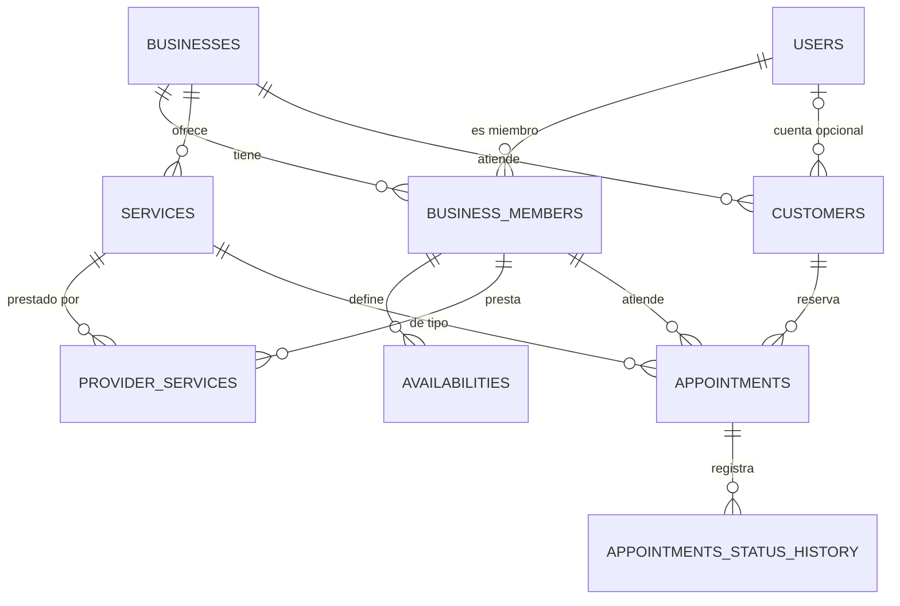
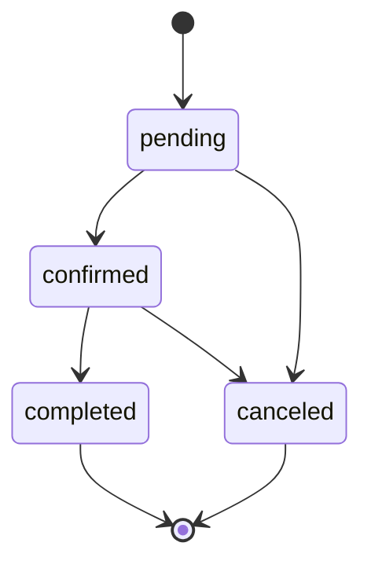

# SchedulingSoftware


API REST para la gestión de citas de negocios de servicios (salud, belleza, logística…): proveedores, servicios, horarios de disponibilidad, clientes y citas con historial de estados.

El objetivo es un producto real, por lo que el foco está en la **integridad de los datos** y en las **reglas de negocio**: una cita solo se crea si el proveedor ofrece el servicio, está disponible a esa hora en la zona horaria del negocio y no se supera la capacidad, incluso con reservas simultáneas.


---

## Índice

- [Funcionalidades](#funcionalidades)
- [Decisiones técnicas destacadas](#decisiones-técnicas-destacadas)
- [Stack](#stack)
- [Arquitectura](#arquitectura)
- [Modelo de datos](#modelo-de-datos)
- [API](#api)
- [Puesta en marcha](#puesta-en-marcha)
- [Desarrollo](#desarrollo)
- [Hoja de ruta](#hoja-de-ruta)

---

## Funcionalidades

- **Negocios** con zona horaria propia (IANA) y moneda (COP / USD).
- **Usuarios y roles:** una persona puede pertenecer a varios negocios con roles distintos (administrador, proveedor o ambos).
- **Servicios** con duración, precio y capacidad de citas simultáneas, ofrecidos por uno o varios proveedores.
- **Disponibilidad semanal** por proveedor, en hora local del negocio, sin bloques solapados.
- **Clientes por negocio**, con o sin cuenta de usuario y con registro del consentimiento de datos personales.
- **Reserva de citas** con validación completa (servicio, proveedor, disponibilidad, capacidad, fechas).
- **Ciclo de vida de la cita** con transiciones controladas e historial de cada cambio de estado.
- **Código de reserva legible** (`K7M-29Q`) para mostrar al cliente.

## Decisiones técnicas destacadas

| Problema | Solución |
|---|---|
| Dos reservas simultáneas podrían superar la capacidad (*overbooking*) | Bloqueo `SELECT … FOR UPDATE` del proveedor antes de contar las citas solapadas: las reservas concurrentes del mismo proveedor se serializan. |
| Las citas son instantes, pero los horarios son "hora de reloj" local | Las citas se guardan como `TIMESTAMPTZ` (UTC) y la disponibilidad como `TIME` local. Para validar, la cita se convierte a la zona horaria del negocio (`zoneinfo`), lo que soporta horario de verano y negocios en distintos países. |
| La cita y su primera fila de historial deben guardarse juntas | Se insertan en una única transacción: se guardan las dos o ninguna. |
| Validaciones que pueden quedar desincronizadas | Cada regla vive en dos capas que dicen lo mismo: restricciones de PostgreSQL (`CHECK`, `UNIQUE`, `NOT NULL`) como red de seguridad, y Pydantic para responder `422` con un mensaje claro. |
| Errores de unicidad poco descriptivos | Las violaciones `UNIQUE` se traducen a `409` por el nombre de la restricción; cualquier otra violación de integridad no se oculta, para detectar validaciones que faltan. |
| Datos con historia que no se pueden perder | Borrado lógico (`active`) y claves foráneas `ON DELETE RESTRICT`. |
| Recursos de un negocio accesibles desde otro | Rutas anidadas (`/business/{business_id}/…`) y comprobación de pertenencia en cada operación: un recurso de otro negocio responde `404`, igual que uno inexistente. |
| Identificadores predecibles | Claves primarias UUID; el código de reserva legible es un campo aparte, generado con `secrets`. |
| Evolución del esquema | Migraciones versionadas con Alembic desde el primer día; los `downgrade` que perderían datos se detienen con un mensaje en lugar de borrar. |

El registro completo de decisiones, con su motivo, está en [`backend/docs/DESICIONES.md`](backend/docs/DESICIONES.md).

## Stack

| Pieza | Tecnología |
|---|---|
| Lenguaje | Python 3.13 |
| Framework web | FastAPI |
| ORM y modelos | SQLModel (SQLAlchemy 2 + Pydantic 2) |
| Base de datos | PostgreSQL 17 en Docker |
| Driver | psycopg 3 |
| Migraciones | Alembic |
| Configuración | pydantic-settings |
| Documentación de la API | OpenAPI + Scalar |
| Calidad de código | Ruff (lint y formato), Pyright (tipado estático) |

## Arquitectura

Arquitectura en capas, con una responsabilidad clara por capa:

```
Router (HTTP)  →  Servicio (reglas de negocio)  →  Repositorio (acceso a datos)  →  PostgreSQL
```

- **Router:** define las rutas, valida la entrada con modelos `Create` / `Update` y la salida con modelos `Public`.
- **Servicio:** aplica las reglas de negocio y decide los códigos HTTP. Recibe sus repositorios por inyección de dependencias.
- **Repositorio:** encapsula las consultas SQL detrás de una interfaz abstracta (`ABC`), lo que permite sustituir la implementación en tests.

```
backend/
├── main.py                  # punto de entrada de FastAPI
├── alembic/                 # migraciones
├── docs/                    # contexto, decisiones de diseño y pendientes
└── App/
    ├── config.py            # configuración desde variables de entorno
    ├── db/models/           # modelos SQLModel (tabla + Create / Public / Update)
    ├── repositories/        # acceso a datos: interfaz abstracta + implementación SQL
    ├── service/             # lógica de negocio
    ├── dependencies/        # inyección de dependencias de FastAPI
    └── routers/             # endpoints, uno por entidad
```

## Modelo de datos



**Estados de una cita:**



## API

La documentación interactiva (OpenAPI) está disponible en `/scalar` al arrancar la aplicación.

| Recurso | Ruta base | Operaciones |
|---|---|---|
| Negocios | `/business` | crear, listar, obtener, actualizar |
| Usuarios | `/users` | crear, listar, obtener, actualizar |
| Miembros | `/business/{business_id}/members` | crear, listar, obtener, actualizar |
| Servicios | `/business/{business_id}/services` | crear, listar, obtener, actualizar |
| Proveedores de un servicio | `/business/{business_id}/services/{service_id}/providers` | añadir, listar, quitar |
| Disponibilidad | `/business/{business_id}/members/{member_id}/availabilities` | crear, listar, obtener, actualizar |
| Clientes | `/business/{business_id}/customer` | crear, listar, obtener, actualizar |
| Citas | `/business/{business_id}/appointments` | crear, listar (filtro por estado), obtener, cambiar estado, editar notas, historial |

**Convenciones:**

- Actualizaciones con `PATCH`: solo se modifican los campos enviados.
- Paginación en todos los listados: `limit` (1–100, por defecto 50) y `offset`, con orden estable.
- Errores con un formato único:

| Código | Cuándo |
|---|---|
| `404` | El recurso no existe o no pertenece al negocio de la URL |
| `409` | Conflicto con el estado actual: duplicado, recurso inactivo, sin capacidad, transición no permitida |
| `422` | Datos inválidos |

### Ejemplo: reservar una cita

```http
POST /business/{business_id}/appointments/
Content-Type: application/json

{
  "client_id": "6f1c…",
  "provider_id": "a2b9…",
  "service_id": "d47e…",
  "starts_at": "2026-12-01T15:00:00-05:00",
  "notes": "Primera visita"
}
```

```json
{
  "id": "0c8d…",
  "booking_code": "K7M-29Q",
  "starts_at": "2026-12-01T20:00:00Z",
  "ends_at": "2026-12-01T20:45:00Z",
  "status": "pending",
  "client_id": "6f1c…",
  "provider_id": "a2b9…",
  "service_id": "d47e…",
  "notes": "Primera visita",
  "created_at": "2026-11-23T14:02:11Z",
  "updated_at": "2026-11-23T14:02:11Z"
}
```

`ends_at` lo calcula el servidor a partir de la duración del servicio. Si el proveedor no está disponible a esa hora:

```json
{ "detail": { "Error": "Provider is not available at that time" } }
```

## Puesta en marcha

**Requisitos:** Python 3.13 y Docker.

```bash
# 1. Clonar
git clone https://github.com/TeitanG/SchedulingSoftware.git
cd SchedulingSoftware

# 2. Base de datos (PostgreSQL en el puerto local 5433)
docker compose up -d

# 3. Entorno virtual y dependencias
cd backend
python -m venv venv
source venv/bin/activate          # Windows: .\venv\Scripts\Activate.ps1
pip install -r requirements.txt
```

**4. Configuración.** La aplicación lee sus variables de un archivo `backend/.env`, que cada desarrollador crea en local y que está excluido del repositorio. Para desarrollo, con la base de datos de `docker-compose.yml`:


Son las credenciales de desarrollo que ya define `docker-compose.yml`; la aplicación no arranca si falta `DATABASE_URL`.

```bash
# 5. Migraciones
alembic upgrade head

# 6. Arrancar
uvicorn main:app --reload
```

La API queda en `http://localhost:8000` y su documentación en `http://localhost:8000/scalar`.

## Desarrollo

```bash
ruff check App          # lint
ruff format App         # formato
pyright App             # tipado estático
alembic check           # comprueba que modelos y base de datos coinciden
```

## Hoja de ruta

- [x] Modelo de datos relacional y migraciones
- [x] Negocios, usuarios, miembros, servicios y proveedores
- [x] Disponibilidad semanal con detección de solapamientos
- [x] Clientes
- [x] Citas: reserva con validación, estados e historial
- [ ] Autenticación y autorización con JWT
- [ ] Endpoint de huecos libres para reservar
- [ ] Tests automatizados con pytest e integración continua
- [ ] Frontend con React + TypeScript + Vite
